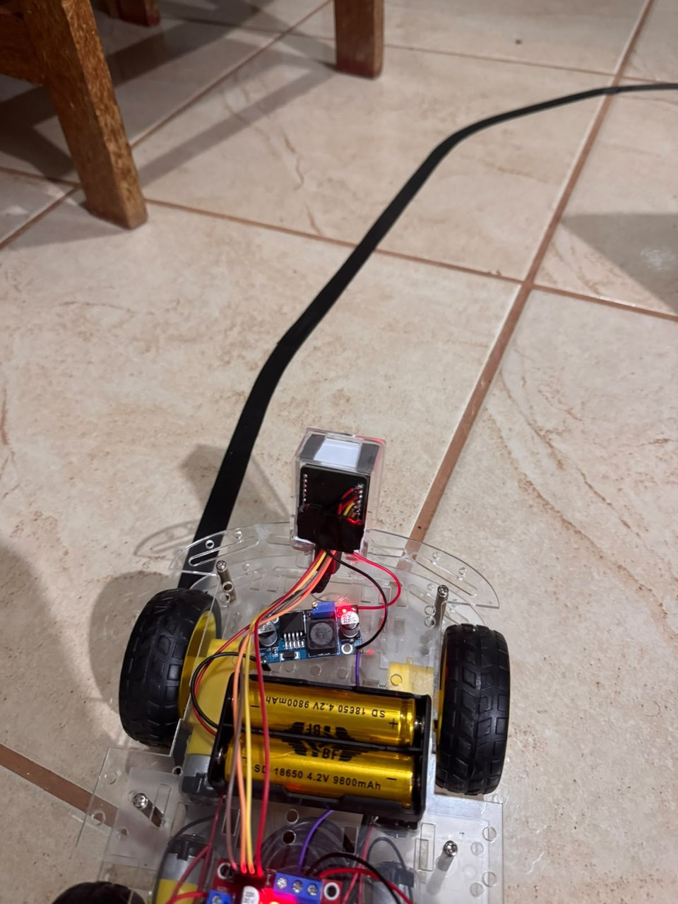
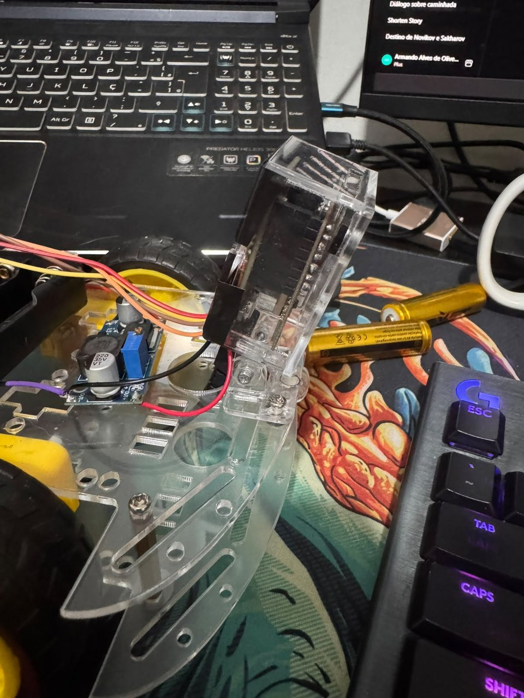
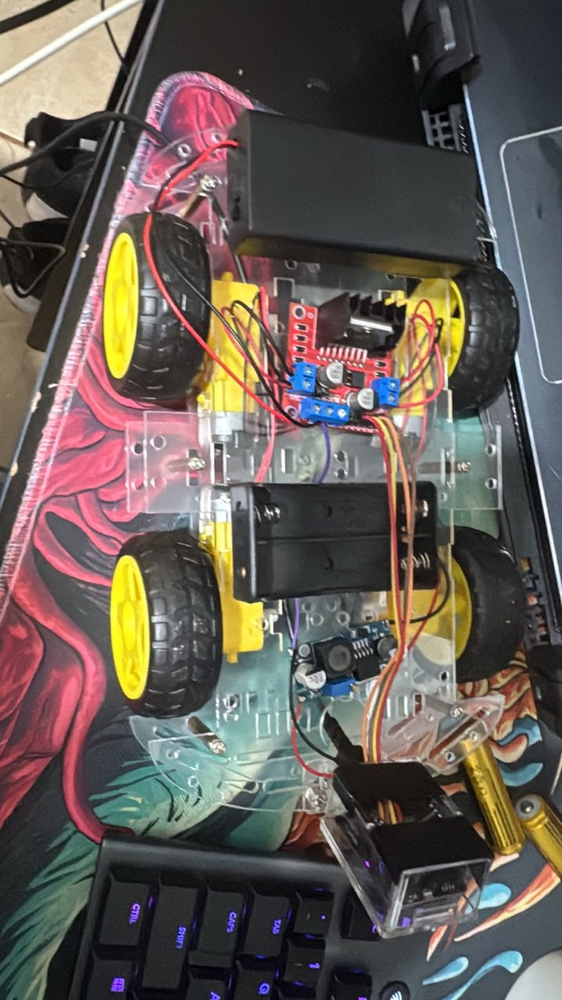
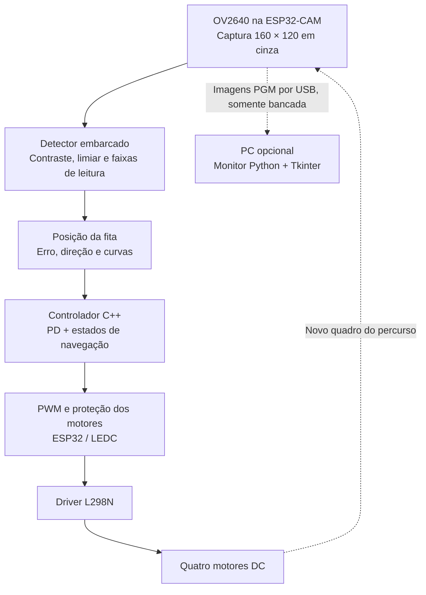

<div align="center">

# 🤖 Carrinho Autônomo com ESP32-CAM

### Seguidor de linha com visão computacional embarcada e controle PD

**Robótica móvel • Processamento de imagens em C++ • Sistemas embarcados**


**[Visão geral](#-visão-geral) · [Fotos](#-galeria-do-protótipo) · [Funcionamento](#-como-funciona) · [Hardware](#-hardware) · [Execução](#-como-executar) · [Código](#-estrutura-do-projeto)**

</div>

---

## 📌 Visão geral

O projeto consiste em um **carrinho autônomo seguidor de linha**, construído com um chassi de quatro rodas, quatro motores DC, uma **ESP32-CAM AI Thinker (câmera OV2640)** e um módulo **L298N** para acionamento dos motores.

A própria **ESP32-CAM captura e interpreta as imagens da pista, calcula os ajustes de direção e controla os motores**. O processamento visual é feito **localmente no firmware C++**, sem necessidade de um computador para conduzir o carrinho durante o percurso.

A detecção identifica regiões **escuras em contraste com o fundo mais claro** da pista. O projeto combina análise de imagem em escala de cinza, antecipação de curvas, controle proporcional-derivativo (PD) e estratégias de recuperação quando a linha deixa de ser encontrada.

> **Arquitetura real:** o firmware não utiliza comunicação Wi-Fi/Bluetooth, armazenamento em cartão SD ou biblioteca OpenCV. O arquivo Python disponível é apenas um **monitor opcional via USB**, destinado a visualização e testes de bancada.

## 📸 Galeria do protótipo

<table>
  <tr>
    <td align="center" width="33%">
      <a href="docs/imagens/carrinho-na-pista.jpg"></a>
      <sub><b>Carrinho na pista</b></sub>
    </td>
    <td align="center" width="33%">
      <a href="docs/imagens/esp32-cam-montagem.jpg"></a>
      <sub><b>ESP32-CAM e montagem</b></sub>
    </td>
    <td align="center" width="33%">
      <a href="docs/imagens/chassi-eletronica.jpg"></a>
      <sub><b>Chassi e eletrônica</b></sub>
    </td>
  </tr>
</table>

*Clique nas fotos para ampliar. As imagens mostram etapas da montagem e do teste, não medições de desempenho.*

## ✨ Funcionalidades implementadas

| Recurso | O que o código faz |
| --- | --- |
| **Visão computacional embarcada** | Processa imagens da OV2640 em escala de cinza diretamente na ESP32-CAM. |
| **Detecção adaptativa da fita** | Analisa contraste e histogramas, calcula limiar de intensidade e examina faixas horizontais da imagem. |
| **Acompanhamento de trajetória** | Estima a posição da fita perto e longe do carrinho, o desvio lateral e a tendência de direção. |
| **Controle PD** | Ajusta a velocidade relativa dos lados esquerdo e direito usando erro e derivada filtrada. |
| **Curvas e cotovelos** | Identifica curvas próximas ou adiante e pode executar giro mais fechado com redução/parada da roda interna. |
| **Cruzamentos** | Diferencia cruzamentos de curvas laterais e tenta atravessar mantendo o movimento à frente. |
| **Reencontro da linha** | Usa memória da última direção observada e movimentos curtos com pausas para procurar novamente a fita. |
| **Proteções de execução** | Trata quadros antigos/inválidos, comandos expirados, perda prolongada da linha e limite de duração. |
| **Monitor de bancada por USB** | Exibe imagens e telemetria, permite salvar PNG/PGM e ajustar uma prévia binarizada, sem controlar a navegação. |

> A tabela descreve **comportamentos presentes no código-fonte**, não garante que todos funcionem perfeitamente em qualquer pista. Iluminação, aderência, alimentação e calibração dos motores influenciam o resultado.

## 🧠 Como funciona



### 1. Captura e interpretação da pista

A câmera **OV2640** é configurada em **QQVGA (160 × 120 pixels)**, formato **`PIXFORMAT_GRAYSCALE`**. O firmware copia os pixels do quadro para memória interna e os analisa na ESP32-CAM.

O detector, em `Seguidor.h`, verifica o contraste da imagem, usa histogramas e referências de intensidade para escolher um limiar e procura candidatos à fita em **23 linhas horizontais**. A posição observada é usada para estimar o erro em relação ao centro da câmera e antecipar mudanças de direção.

### 2. Correção de trajetória

O controlador combina **erro lateral** e **variação do erro** por meio de controle **PD**, gerando comandos diferentes para os lados esquerdo e direito. A configuração atual contém `KP = 1.65` e `KD = 0.045`.

Além do seguimento normal, há estados explícitos para **parada (`STOP`)**, **seguimento (`FOLLOW`)**, **cruzamento (`CROSS`)**, **giro (`PIVOT`)**, **busca (`SEARCH`)** e **falha (`FAULT`)**.

### 3. Situações especiais

- **Curvas:** a lógica usa informações próximas e distantes da imagem para antecipar desacelerações e ajustar a diferença entre as rodas.
- **Curvas fechadas:** quando confirmadas, o controlador pode entrar em `PIVOT` para reduzir o raio de giro.
- **Cruzamentos:** a detecção busca evidência de continuidade da pista e confirma a situação ao longo de vários quadros antes de atravessar.
- **Perda temporária da fita:** o estado `SEARCH` tenta reencontrá-la com movimentos em pulsos, usando a última direção confiável por um intervalo limitado.
- **Falhas:** imagens inválidas/antigas, expiração de comandos ou perda prolongada de referência podem interromper o movimento.

## 🔧 Hardware

| Componente | Papel |
| --- | --- |
| **ESP32-CAM AI Thinker + OV2640** | Captura de imagens e execução do algoritmo e do controle. |
| **Chassi 4WD + 4 motores DC** | Tração e direção diferencial. |
| **L298N** | Acionamento e inversão de sentido dos motores. |
| **LM2596 (conversor DC-DC)** | Regulação de tensão da montagem. |
| **Baterias, suportes e fios** | Alimentação e interligação dos componentes. |
| **Base ESP32-CAM-MB (para bancada)** | Programação e comunicação serial USB. |

**Pinos definidos em `Config.h`:** `IN1 = GPIO12`, `IN2 = GPIO13`, `IN3 = GPIO14`, `IN4 = GPIO15`. O firmware usa **PWM por LEDC** para comandar o L298N.

> ⚠️ **Segurança:** confira polaridade, tensões e capacidade de corrente antes de energizar. Mantenha GND comum onde exigido pelo circuito, não alimente os motores pelos GPIOs e verifique o comportamento de inicialização dos pinos GPIO12–15 da ESP32 antes de conectar o driver.

## 💻 Software e tecnologias

- **C++ / Arduino ESP32:** firmware, detector visual, controle PD, máquina de estados e PWM.
- **Driver `esp_camera`:** captura embarcada da OV2640 em tons de cinza.
- **LEDC e FreeRTOS:** geração de PWM e tarefa dedicada ao acionamento dos motores.
- **Python 3.9+ / Tkinter:** interface opcional para visualizar a câmera via USB, **sem executar a navegação**.
- **pySerial:** comunicação pela porta COM com o firmware no modo de bancada.
- **Git / GitHub:** versionamento e documentação.

## ▶️ Como executar

### A. Firmware na ESP32-CAM

1. Abra **`DeuCerto.ino`** na Arduino IDE, com os arquivos `.h` do projeto na mesma pasta do sketch.
2. Selecione a placa **AI Thinker ESP32-CAM** (ESP32 clássico). O cabeçalho do firmware registra o pacote **Espressif 3.3.12** como referência de compilação.
3. Confira o circuito e as configurações em **`Config.h`** antes de ligar os motores. A câmera precisa ser **OV2640** e a placa precisa ter **PSRAM** disponível.
4. Escolha o modo de funcionamento em `Config.h`, grave o firmware e monitore mensagens pela porta serial em **115200 baud** quando necessário.

**Modo de competição (`COMPETICAO = true`, valor atual):** após inicializar câmera e motores, o carrinho **observa a pista parado** e busca uma sequência de **15 quadros alinhados** para iniciar o percurso. A busca inicial dura até **5 s por tentativa**, com **pausas de 3 s** entre tentativas. A condução é autônoma e os comandos seriais de bancada não ficam disponíveis nesse modo.

**Modo de bancada (`COMPETICAO = false`):** permite iniciar/parar por comandos seriais, testar os motores e capturar imagens para inspeção. **Trocar esse parâmetro exige gravar novamente o firmware.**

### B. Monitor opcional de câmera (somente bancada)

Para visualizar a câmera no computador, primeiro use **`COMPETICAO = false`** e conecte a base da placa por **USB**. No Windows, execute **`AbrirCamera.cmd`** ou, com Python instalado:

```powershell
python -m pip install pyserial==3.5
python monitor_camera.py
```

É necessário **Python 3.9+ com Tkinter**. O monitor permite selecionar a porta COM, capturar imagens, mostrar faixas de leitura, alternar a **prévia binarizada** e salvar imagens **PNG/PGM**. A imagem chega por **serial USB**; o controle de limiar nessa janela altera **somente a prévia**, não os parâmetros do detector que conduz o carrinho.

> O monitor funciona apenas com a placa parada no modo de bancada; não é uma transmissão Wi-Fi nem um painel de pilotagem remota. A própria interface informa que as capturas USB podem levar aproximadamente dois segundos.

### Comandos seriais de bancada

| Comando | Ação |
| --- | --- |
| `h` | Exibe a ajuda. |
| `s` | Solicita partida após espera e confirmação da fita. |
| `x` | Para ou cancela testes. |
| `v` | Imprime uma representação ASCII da imagem, com o carrinho parado. |
| `g` | Envia um quadro PGM binário pela serial, com o carrinho parado. |
| `p 140 140 700` | Teste temporizado de PWM dos dois lados; use com as rodas suspensas. |

**Esses comandos são desativados quando `COMPETICAO = true`.**

## 📁 Estrutura do projeto

```text
Carrinho-Autonomo-ESP32CAM/
├── DeuCerto.ino             # Inicialização, câmera e laço principal embarcado
├── Config.h                 # Parâmetros do detector, controle e pinos
├── Seguidor.h               # Análise da linha e lógica de navegação
├── Motores.h                # PWM, acionamento e proteção dos motores
├── Partida.h                # Regras de alinhamento e partida automática
├── CameraPreview.h          # Tratamento de quadros após prévia de bancada
├── monitor_camera.py        # Visualização da câmera por serial USB
├── AbrirCamera.cmd          # Inicializador do monitor no Windows
├── docs/
│   └── imagens/
│       ├── carrinho-na-pista.jpg
│       ├── esp32-cam-montagem.jpg
│       └── chassi-eletronica.jpg
└── README.md
```

*A estrutura reflete os arquivos de código analisados e a pasta de imagens deste README. Outros arquivos auxiliares do seu repositório podem ser mantidos.*

## ⚙️ Parâmetros de referência

| Parâmetro | Configuração atual |
| --- | --- |
| Resolução | `160 × 120` |
| Faixas horizontais | `23` |
| Ganho proporcional `KP` | `1.65` |
| Ganho derivativo `KD` | `0.045` |
| Frequência do PWM | `1000 Hz` |
| Memória para reencontro | `8000 ms` |
| Idade máxima de quadro | `220 ms` |
| Expiração de comando | `300 ms` |
| Duração máxima de percurso | `600000 ms` (10 min) |

Esses valores pertencem ao código fornecido e são **parâmetros experimentais**, não medições ou garantias de desempenho. Para ajustar o carrinho, consulte `Config.h` e valide as alterações em bancada.

## 🧪 Desafios e limitações

- Mudanças de iluminação, sombras, reflexos e baixo contraste podem comprometer a detecção da fita escura.
- Cruzamentos e curvas muito fechadas podem produzir padrões visuais semelhantes e exigir ajustes finos.
- A resposta depende da montagem, da tração, do fornecimento de energia e das diferenças entre os motores.
- A estratégia de reencontro usa memória limitada: não garante recuperar a linha em todas as situações.
- A prévia USB é uma **ferramenta de diagnóstico com o carrinho parado**, não um fluxo contínuo para dirigir o robô.
- O código possui mecanismos de proteção, mas a execução em hardware e a calibração elétrica devem ser verificadas antes de testes em movimento.

## 🔭 Próximos passos

- [ ] Adicionar vídeo demonstrando o robô em uma pista real.
- [ ] Documentar testes repetidos de retas, cruzamentos e curvas fechadas.
- [ ] Registrar resultados de tempo de percurso e taxa de recuperação da linha.
- [ ] Publicar um esquema elétrico revisado da montagem.

## 🎓 Contexto acadêmico

Projeto experimental de **robótica móvel e visão computacional**, desenvolvido para aplicar conhecimentos de **Ciência da Computação**, sistemas embarcados, processamento digital de imagens e controle de movimento.

## 👨‍💻 Autor

**Armando Braga**  
Ciência da Computação — Universidade Estadual do Norte do Paraná (UENP)

[](https://github.com/Bragarmando25)
[](https://www.linkedin.com/in/armando-braga-4169b2253/)

---

<div align="center">

**Câmera + C++ embarcado + controle PD + robótica móvel**

*Da imagem capturada ao movimento das rodas: todo o ciclo de navegação acontece na ESP32-CAM.*

</div>
